# Learner Workflows: From First Enquiry to Last Lesson

This document maps every learner-facing workflow in the application as implemented in code: what triggers each step, when it runs, which class/method does the work, what is sent (and on which channel), and to whom. It was produced by reading the code only; anything that cannot be determined from the code is called out explicitly.

Key config (all defaults shown are the code defaults; env can override):

| Config key | Default | Read via |
|---|---|---|
| `booking_payments.learner_hold_minutes` | `10` | `App\Support\BookingPayments::learnerHoldExpiresAt()` |
| `booking_payments.minimum_hold_minutes` | `15` | `BookingPayments::staffHoldExpiresAt()`, `instructorHoldExpiresAt()` |
| `booking_payments.instructor_hold_hours_before_lesson` | `48` | `BookingPayments::instructorHoldExpiresAt()` |
| `booking_payments.weekly_payment_due_hours_before_lesson` | `48` | `BookingPayments::weeklyPaymentDueAt()` / `weeklyPaymentDueDate()` |
| `booking_payments.late_cancellation_hours` | `48` | `BookingPayments::isLateCancellation()` |
| `booking_payments.timezone` | `Europe/London` | `BookingPayments` |
| `booking.instructor_ids.{manual,automatic,both}` | env `BOOKING_INSTRUCTOR_*_ID` | `Booking\StepTwoController` |
| `booking.admin_email` | env `ADMIN_EMAIL` | `Booking\StepTwoController::notifyAdmin()` |
| `onboarding.learner_minimum_age` | `17` | Onboarding step validation |
| `onboarding.entry_hosts` | `app.drive-plus.co.uk` | `/` route: entry host → `/onboarding`, otherwise → `/booking` |
| `lessons.recommendations_delay_minutes` | `120` | `ProcessResourceRecommendationsJob` delay |
| `fees.booking_fee` / `fees.digital_fee_per_hour` | `19.99` / `1.80` | Order creation |
| `test_pass_guarantee.price` / `free_minimum_hours` | `50` / `10` | `GrantTestPassGuaranteeAction` |
| `mail.head_office_address` | env `HEAD_OFFICE_EMAIL` | Head-office "action required" mails |
| `services.bird.enabled` | `true` | `BirdContactService` |
| `services.instructor.search_radius_miles` | `10` | `InstructorService::findByPostcode()` |

Hard-coded values worth knowing: onboarding availability window is now+2 days to now+56 days (`Onboarding\StepFourController`); account deletion grace period is 30 days (`CreateAccountDeletionRequestAction::GRACE_PERIOD_DAYS`); `SendLessonInvoices` and `GetPaymentRemindersDueAction` use a literal `48` hours rather than the config key.

## Legend: channels

| Channel | Mechanism | Notes |
|---|---|---|
| **Email (templated)** | Queued `Notification` (mail channel) or `Mailable` using `RendersTemplatedMail` + `EmailTemplateService`, keyed by `EmailTemplateKey` (e.g. `learner.payment_link`) | Editable in the owner admin at `/email-templates`. The whole subject/body/sign-off is editable; sending code only supplies simple `{{placeholders}}` (names, dates, amounts, lists) and true/false conditions used as `{{#if name}}…{{else}}…{{/if}}`. Available placeholders/conditions per template are declared in `App\Mail\EmailTemplateCatalog` |
| **Email (hard-coded)** | Blade Mailable or inline `MailMessage` | Not editable via templates |
| **Push** | `PushNotificationService::queueIfHasToken()` writes a `PENDING` `PushNotification` row; `push:send-queued` sends via Expo every minute | Only if the user has an Expo token; no retry after a failed send |
| **In-app message** | `Message` model; `MessageObserver` fans out email + push | |
| **Bird CRM** | `BirdContactService` contact upsert (PATCH) | The app itself sends **no SMS or WhatsApp**. Any SMS/WhatsApp would come from Bird automations, which are not visible in this codebase |
| **Stripe** | Checkout sessions, invoices, Connect transfers, webhooks at `/webhook/stripe` | Whether Stripe itself emails invoices/receipts depends on Stripe dashboard settings, which are not visible in code |

## Top-level journey

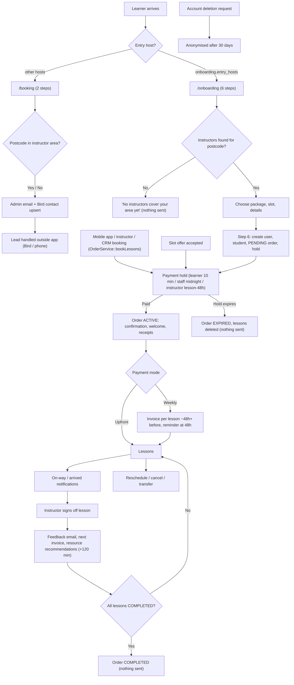

---

## 1. Enquiry / onboarding

Two separate front doors exist.

### 1a. `/booking` (short lead form)

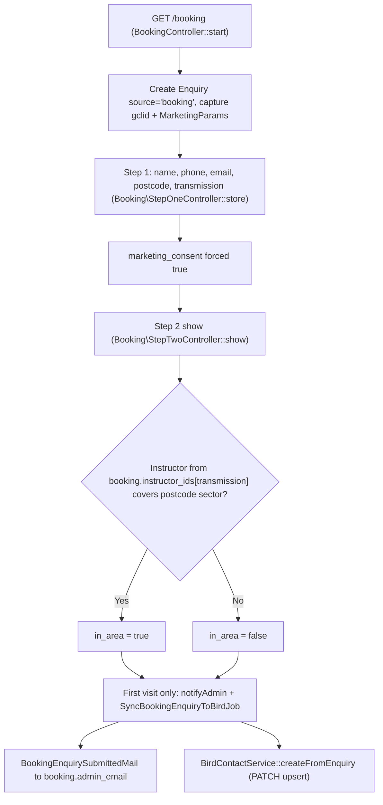

| Step | Trigger & timing | What happens (code ref) | Sent (channel → template/notification) | Recipient |
|---|---|---|---|---|
| 1 | Visitor hits `/booking` | `BookingController::start` creates `Enquiry` (`source='booking'`), stores `tracking` `{gclid, source:'Google ads'}` when gclid present, forwards `MarketingParams::KEYS` (gclid, gbraid, wbraid, fbclid, utm_*) | — | — |
| 2 | Step 1 submit | `Booking\StepOneController::store` normalises postcode, sets `marketing_consent = true` ("bundled consent per client instruction") | — | — |
| 3 | Step 2 first view | `Booking\StepTwoController::show` resolves instructor via `config('booking.instructor_ids')[transmission]`, checks their locations against the postcode sector → `in_area` | — | — |
| 4 | Same request, first visit only | `notifyAdmin()` → `Mail::send` (synchronous, not queued) | Email (hard-coded) → `BookingEnquirySubmittedMail`, view `emails.booking-enquiry-submitted`, subject prefixed `[In area]` / `[Out of area]` | `booking.admin_email` (if unset: logged only) |
| 5 | Same request, first visit only | `SyncBookingEnquiryToBirdJob` (tries 3, backoff 30s) → `BirdContactService::createFromEnquiry` | Bird CRM contact upsert: firstName, lastName, postalCode, `instructorAvailability` Yes/No, `transmission1`, `subscribedEmail/Sms/WhatsApp` = consent, source, gclid; phone E.164; added to `services.bird.booking_list_id` when consented | Bird (CRM) |
| 6 | Learner sees result | In area: CTA to continue. Out of area (`Booking/Step2.vue`): "Try a nearby postcode", "Call us", "We'll notify you when we expand" | Nothing sent to learner by the app | — |

### 1b. `/onboarding` (full self-serve booking)

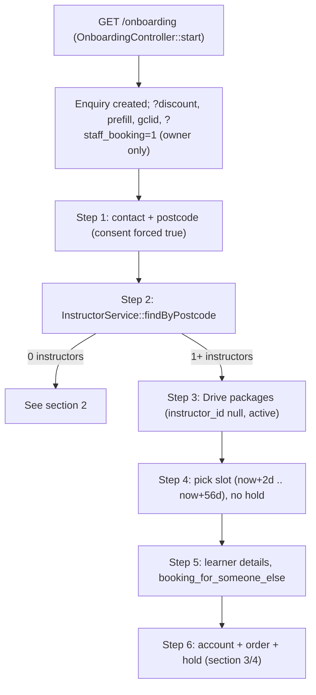

| Step | Trigger & timing | What happens (code ref) | Sent (channel → template/notification) | Recipient |
|---|---|---|---|---|
| 1 | Visit `/onboarding` | `OnboardingController::start`: accepts `?discount`; prefill (`first_name`, `last_name`, `email`, `instructor_id` → skips to step 3); gclid tracking; `?staff_booking=1` (owner only, guests redirected to login) | — | — |
| 2 | Step 1 submit | Postcode normalised, marketing consent forced, `booking_for_other` logged | — | — |
| 3 | Enquiry create/update | `EnquiryObserver` logs only ("TODO: Replace with actual HTTP call to marketing system") | Nothing | — |
| 4 | Step 2 | `InstructorService::findByPostcode` (radius `services.instructor.search_radius_miles` = 10, excluding `onboarding.excluded_instructor_ids`) | — | — |
| 5 | Admin view | `/enquiries` uses `EnquiryService` / `GetFilteredEnquiriesAction`: buckets by `max_step_reached` (2 = completed `/booking`, 6 = full onboarding, else in progress) and area (in/out/unknown) | — (staff can follow up manually) | — |

---

## 2. No instructor available

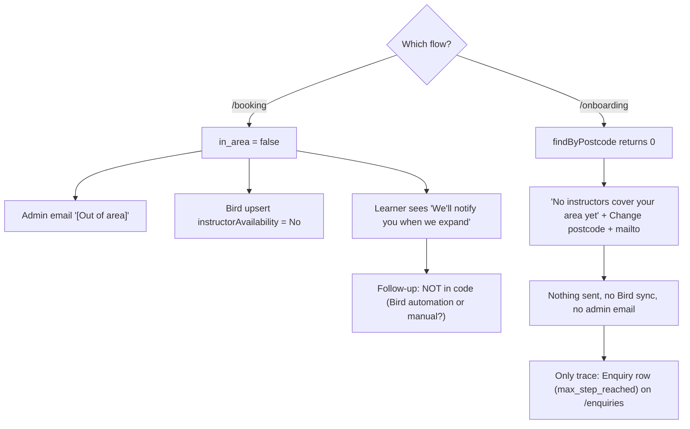

| Step | Trigger & timing | What happens (code ref) | Sent (channel → template/notification) | Recipient |
|---|---|---|---|---|
| 1 | `/booking` step 2, out of area | `Booking\StepTwoController::show` (in_area false) | Email (hard-coded) → `BookingEnquirySubmittedMail` `[Out of area]` | `booking.admin_email` |
| 2 | Same | `SyncBookingEnquiryToBirdJob` | Bird contact upsert with `instructorAvailability = No` | Bird |
| 3 | Same | `Booking/Step2.vue` out-of-area UI | Nothing to learner | — |
| 4 | Later "we'll notify you when we expand" | **Not implemented in code.** There is no expansion-notify job, list, or command. Could happen via Bird automations on `booking_list_id`, which can't be determined from the code | Unknown | Unknown |
| 5 | `/onboarding` step 2, zero instructors | `Onboarding/Step2.vue` empty state | Nothing (no email, no Bird, no admin alert) | — |
| 6 | Slot offers | Unrelated to this branch: `CreateSlotOfferAction` only targets an instructor's *existing* active students | — | — |

---

## 3. Instructor selection, package and registration

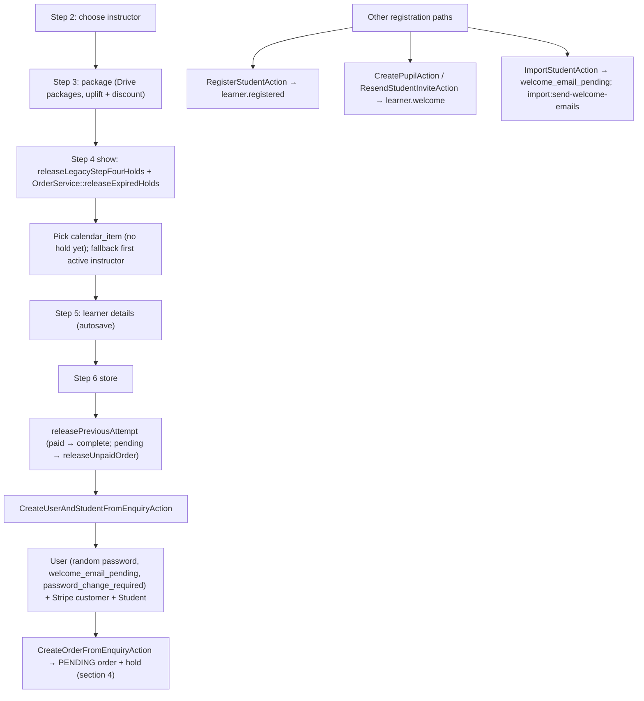

| Step | Trigger & timing | What happens (code ref) | Sent (channel → template/notification) | Recipient |
|---|---|---|---|---|
| 1 | Step 3 | `Onboarding\StepThreeController`: packages with `instructor_id` null, active, `visibleToPupils` (unless staff booking); price uplift + discount | — | — |
| 2 | Step 4 view | `Onboarding\StepFourController::show` calls `releaseLegacyStepFourHolds()` and `OrderService::releaseExpiredHolds()`; records chosen `calendar_item` only | — | — |
| 3 | Step 5 | `Onboarding\StepFiveController` collects learner details, `booking_for_someone_else`; autosave | — | — |
| 4 | Step 6 submit | `releasePreviousAttempt()`: previous order paid → redirect to complete; pending → `OrderService::releaseUnpaidOrder(..., 'learner_restarted_checkout')` | Nothing | — |
| 5 | Step 6 submit | `CreateUserAndStudentFromEnquiryAction`: user = learner (step 5 email if booking for someone else, otherwise step 1), random password, `welcome_email_pending = true`, `password_change_required`; Stripe customer; `Student` updateOrCreate. Booking for someone else → `contact_*` from step 1, `owns_account = false`. **Does not set `students.instructor_id`** (set on payment) | Nothing yet (welcome is deferred to payment) | — |
| 6 | API `register/student` or Fortify `CreateNewUser` | `RegisterStudentAction` | Email (templated) → `StudentRegisteredNotification` (`learner.registered`) | Learner |
| 7 | Instructor adds pupil / resends invite | `CreatePupilAction`, `ResendStudentInviteAction` | Email (templated) → `WelcomeStudentNotification` (`learner.welcome`) with temporary password | Learner |
| 8 | Data import | `ImportStudentAction` sets `welcome_email_pending = true`; manual `import:send-welcome-emails` → `SendImportedWelcomeEmailAction` → `ResendStudentInviteAction` | Email (templated) → `learner.welcome` | Imported learner |
| 9 | Instructor PIN attach | `AttachStudentToInstructorAction` (API `students/attach`) | Nothing | — |
| 10 | Admin assigns | `AssignStudentToInstructorAction` | Email (templated) → `StudentAssignedByAdminNotification` (`instructor.student_assigned`) | Instructor |
| 11 | Admin password reset | `AdminResetPasswordAction` | Email (templated) → `PupilPasswordResetMail` (`learner.password_reset`) | Learner |

---

## 4. Booking and payment

Entry points that create a PENDING order with a hold:

| Entry point | Hold | Payment path |
|---|---|---|
| Onboarding step 6 (self) | `learnerHoldExpiresAt` = now + 10 min | Stripe Checkout, source `onboarding` |
| Onboarding step 6 (`staff_booking`) | `staffHoldExpiresAt` = next UK midnight, min 15 min | `OrderService::sendPaymentLink(..., 'staff_onboarding', true)` |
| API `StudentOrderController::store` (student-initiated) | learner hold (10 min) | Checkout URL, source `mobile_app` |
| API / CRM instructor booking (`StudentOrderController::store`, `PupilController::storeOrder`) | `instructorHoldExpiresAt` = first lesson − 48h, min 15 min from now | `SendPaymentLinkEmailAction` (`instructor_booking`) |
| `AcceptSlotOfferAction` | learner hold (10 min) | Checkout URL |

Stripe Checkout `expires_at` is clamped by `BookingPayments::stripeCheckoutExpiresAt()` to between 31 minutes and 23h50m. With a 10-minute learner hold, the Stripe session therefore outlives the app hold. `checkout.session.expired` only releases the order if the app hold has also expired.

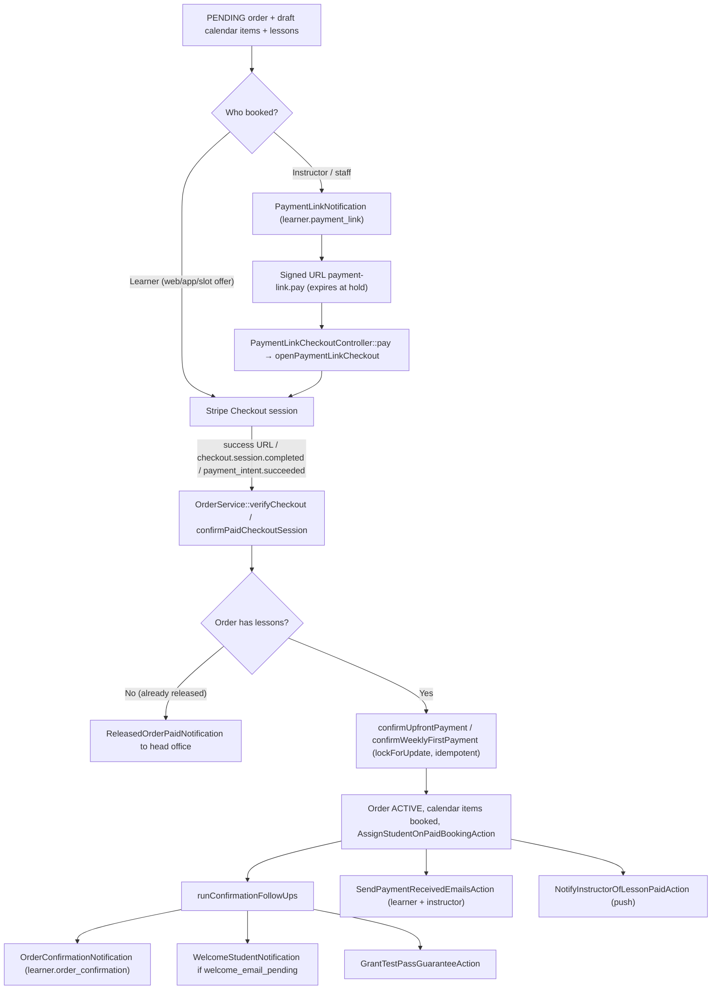

| Step | Trigger & timing | What happens (code ref) | Sent (channel → template/notification) | Recipient |
|---|---|---|---|---|
| 1 | Order creation | `CreateOrderFromEnquiryAction` / `CreateOrderFromApiAction`: PENDING order, fees, guarantee, draft calendar items, lessons; weekly → `LessonPayment` rows (`DUE`, `due_date` = `weeklyPaymentDueDate`, i.e. lesson − 48h as UK date); `payment_hold_expires_at` set | — | — |
| 2 | Instructor booking via `bookLessons` | `OrderService::checkDraftItemClashes` | Email (templated) → `CalendarClashDetectedNotification` (`instructor.calendar_clash`) | Instructor |
| 3 | Instructor/staff booking | `SendPaymentLinkEmailAction` / `OrderService::sendPaymentLink`; sets `invoice_sent_at` | Email (templated) → `PaymentLinkNotification` (`learner.payment_link`) | `contact_email` if `owns_account = false`, otherwise student email |
| 4 | Resend (API `resendPaymentLink`, rate-limited to 1 per 180 s) | `OrderService::resendPaymentLink` | Email → `learner.payment_link`; plus Push `payment_link_resent` ("Payment link re-sent") if not a staff booking, the learner owns the account, and has a token | Contact/learner; push to learner |
| 5 | Learner opens link | `PaymentLinkCheckoutController::pay` → `openPaymentLinkCheckout` (reuses an open session or creates one); `success` → verify; `cancel` → order stays pending | — | — |
| 6 | Payment success | `OrderService::verifyCheckout` → `confirmUpfrontPayment` (creates PAID `LessonPayment` per lesson) or `confirmWeeklyFirstPayment`; order ACTIVE; items booked; `AssignStudentOnPaidBookingAction` sets `students.instructor_id` (moves from previous instructor) | — | — |
| 7 | Same, follow-ups | `runConfirmationFollowUps` → `SendOrderConfirmationEmailAction` | Email (templated) → `OrderConfirmationNotification` (`learner.order_confirmation`) | Contact (if not account owner) or learner |
| 8 | Same | `sendWelcomeEmailIfPending` (inside `SendOrderConfirmationEmailAction`) when `welcome_email_pending` | Email (templated) → `WelcomeStudentNotification` (`learner.welcome`) with temporary password | Learner user |
| 9 | Same | `GrantTestPassGuaranteeAction` (free if paid in full and ≥ 10h, else £50 add-on) | — | — |
| 10 | Same | `sendFirstPaymentEmails` → `SendPaymentReceivedEmailsAction` | Email (templated) → `LessonPaymentReceivedNotification` (`learner.lesson_payment_received`); `InstructorLessonPaymentReceivedNotification` (`instructor.lesson_payment_received`) | Contact/learner; order's instructor |
| 11 | Same | `NotifyInstructorOfLessonPaidAction` | Push `lesson_paid` ("Lesson paid" / "Lessons paid") | Instructor |
| 12 | Payment for an already released order | `OrderService::reportPaymentForReleasedOrder` (cache dedupe 30 days) | Email (hard-coded `MailMessage`) → `ReleasedOrderPaidNotification` "Action Required: Refund for a Payment on a Released Booking" | `mail.head_office_address` |
| 13 | `payment_intent.payment_failed` webhook | `WebhookController` logs only | Nothing | — |

---

## 5. Unpaid / expired holds

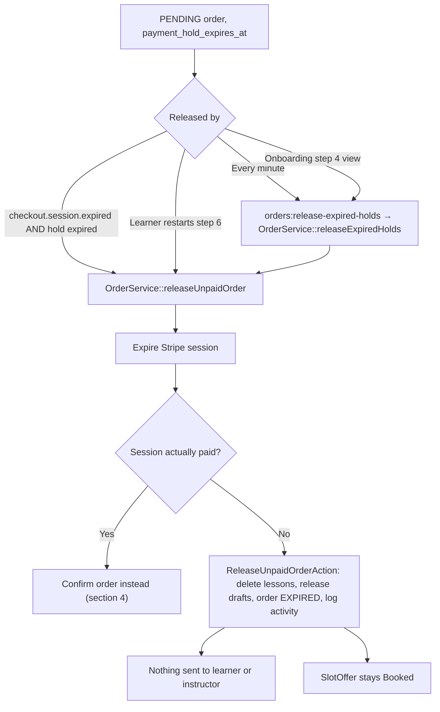

| Step | Trigger & timing | What happens (code ref) | Sent (channel → template/notification) | Recipient |
|---|---|---|---|---|
| 1 | `orders:release-expired-holds`, every minute, `withoutOverlapping` | `OrderService::releaseExpiredHolds()` for PENDING orders with `payment_hold_expires_at <= now` | — | — |
| 2 | Each order | `releaseUnpaidOrder()` expires the Stripe session; if paid → confirm; else `ReleaseUnpaidOrderAction` | Nothing | — |
| 3 | `checkout.session.expired` webhook | Releases only if the app hold has also expired | Nothing | — |
| 4 | `calendar:cleanup-drafts`, daily 00:00 | Removes orphaned draft calendar items | Nothing | — |
| 5 | Late payment after release | See step 12 in section 4 | Email (hard-coded) → `ReleasedOrderPaidNotification` | Head office |

Hold timings in summary: learner 10 min; staff booking until next UK midnight (minimum 15 min); instructor booking until first lesson − 48h (minimum 15 min from now). The payment-link signed URL expires at the hold expiry, or now + 1 day if there is no hold.

---

## 6. Weekly payments

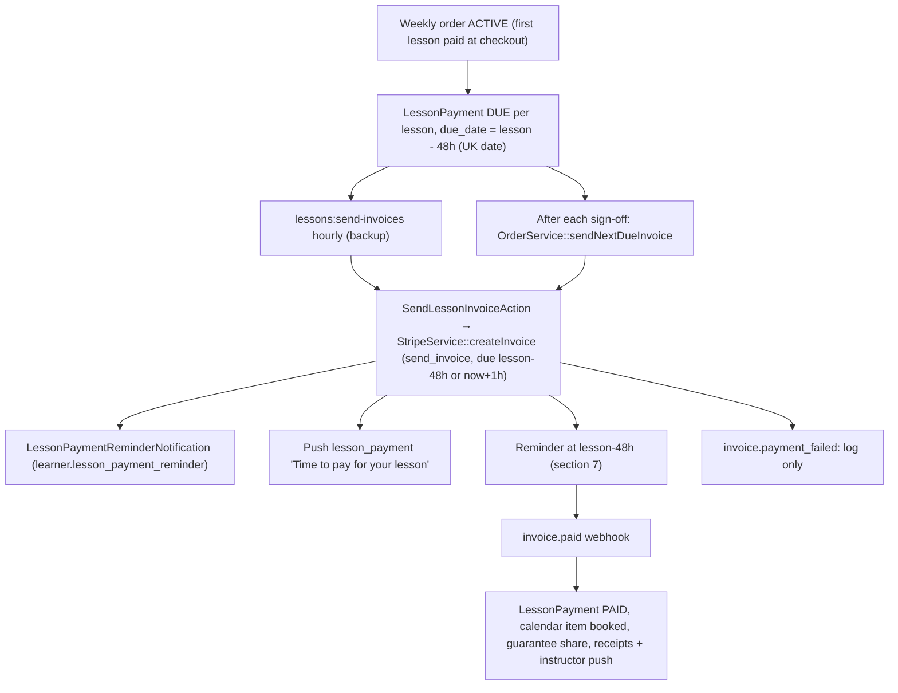

| Step | Trigger & timing | What happens (code ref) | Sent (channel → template/notification) | Recipient |
|---|---|---|---|---|
| 1 | Sign-off of previous lesson | `OrderService::sendNextDueInvoice` invoices the next DUE, un-invoiced, non-cancelled lesson (ACTIVE weekly orders) | As step 3 | |
| 2 | `lessons:send-invoices`, hourly, `withoutOverlapping` | `SendLessonInvoices`: `status = DUE`, `stripe_invoice_id` null, `due_date <= now()+48h` (literal 48), lesson not cancelled, order ACTIVE + WEEKLY, user has `stripe_customer_id` | As step 3 | |
| 3 | Invoice created | `SendLessonInvoiceAction` → `StripeService::createInvoice` (`collection_method = send_invoice`, `auto_advance`, `due_date` = lesson − 48h or now+1h if past), `finalizeInvoice` | Email (templated) → `LessonPaymentReminderNotification` (`learner.lesson_payment_reminder`); Push `lesson_payment` ("Time to pay for your lesson") | Email: contact/learner; push: `student->user` if token (no `owns_account` check) |
| 4 | CRM resend | `PupilController::resendLessonInvoice` → `ResendLessonInvoiceAction` | Email → `learner.lesson_payment_reminder` (no push) | Contact/learner |
| 5 | `invoice.paid` webhook (skipped if metadata source `checkout`) | Marks `LessonPayment` PAID, books calendar item, grants guarantee if guarantee share > 0, logs activity | Email → `learner.lesson_payment_received` + `instructor.lesson_payment_received`; Push `lesson_paid` | Contact/learner; order instructor |
| 6 | `invoice.payment_failed` | Log only ("future enhancement") | Nothing | — |
| 7 | Invoice still unpaid at lesson time | No automated action. `SignOffLessonAction` refuses sign-off for weekly lessons with an unpaid `LessonPayment` | Nothing | — |

---

## 7. Reminders and on-way / arrived

`reminders:send` runs every 5 minutes (`withoutOverlapping`) → `ReminderService::dispatchAll`. Deduplication uses `LessonReminder` rows with `ReminderType` values `miles_start`, `miles_end` and `payment_due_48h`.

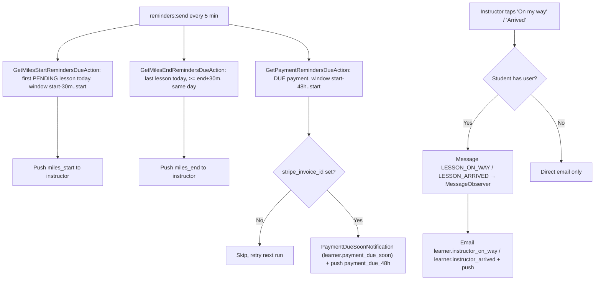

| Step | Trigger & timing | What happens (code ref) | Sent (channel → template/notification) | Recipient |
|---|---|---|---|---|
| 1 | Every 5 min, window [first lesson start − 30 min, start) | `GetMilesStartRemindersDueAction` | Push `miles_start` ("Mileage reminder") | Instructor |
| 2 | Every 5 min, ≥ last lesson end + 30 min, same day | `GetMilesEndRemindersDueAction` | Push `miles_end` | Instructor |
| 3 | Every 5 min, window [lesson start − 48h, start) (literal 48), lesson not DRAFT/CANCELLED/COMPLETED, no `payment_due_48h` row | `GetPaymentRemindersDueAction` → `SendPaymentReminderAction` (requires `stripe_invoice_id`, otherwise skips and retries) | Email (templated) → `PaymentDueSoonNotification` (`learner.payment_due_soon`); Push `payment_due_48h` ("Payment reminder") if `owns_account` and token | Email: `student->getBookerDetails()` email; push: learner |
| 4 | Instructor POST `instructor/lessons/{lesson}/notify-on-way` | `InstructorService::notifyStudentOnWay` → `Message` (`LESSON_ON_WAY`) → `MessageObserver::handleLessonStatus` | Email (templated) → `InstructorOnWayNotification` (`learner.instructor_on_way`); Push `instructor_on_way` | Student email (falls back to `contact_email`); push to learner user |
| 5 | Instructor POST `.../notify-arrived` | `InstructorService::notifyStudentArrived` → `Message` (`LESSON_ARRIVED`) | Email (templated) → `InstructorArrivedNotification` (`learner.instructor_arrived`); Push `instructor_arrived` | As above |
| 6 | On-way/arrived, student has no user | Direct email | Email → same notifications | Student/contact email |
| 7 | Learner "lesson tomorrow" reminder | **Not implemented**: no learner lesson-time reminder exists on any channel | — | — |

---

## 8. Reschedule, cancellation, refunds and transfer

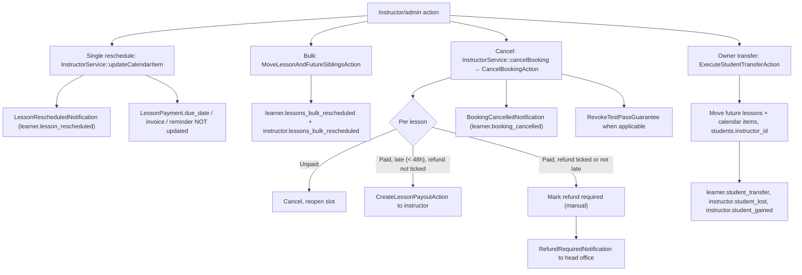

| Step | Trigger & timing | What happens (code ref) | Sent (channel → template/notification) | Recipient |
|---|---|---|---|---|
| 1 | Instructor changes a lesson time (web `InstructorController`, API `InstructorCalendarController::update`) | `InstructorService::updateCalendarItem` → `UpdateCalendarItemAction::syncLessonDates`; `notifyStudentsOfReschedule` when the time changes | Email (templated) → `LessonRescheduledNotification` (`learner.lesson_rescheduled`) | Student's user |
| 2 | Bulk move of lesson + future siblings | `MoveLessonAndFutureSiblingsAction` | Email → `LessonsBulkRescheduledStudentNotification` (`learner.lessons_bulk_rescheduled`); `LessonsBulkRescheduledInstructorNotification` (`instructor.lessons_bulk_rescheduled`) | Student's user; instructor |
| 3 | Instructor/admin cancels (web or API) | `CancelBookingAction`: per-lesson outcome using `BookingPayments::isLateCancellation` (48h); reopens slots; order CANCELLED if no open lessons remain; notes on instructor profile | Email (templated) → `BookingCancelledNotification` (`learner.booking_cancelled`) | Student's user only |
| 4 | Late cancel, paid, "Refund Lesson" not ticked | `CreateLessonPayoutAction` (Stripe Connect transfer to instructor) | Nothing (a balance-shortfall failure here sends no manual-payout email) | — |
| 5 | Refund needed | No Stripe refund API call; refunds are manual | Email (hard-coded `MailMessage`) → `RefundRequiredNotification` "Action Required: Refund for Cancelled Booking" | `mail.head_office_address` |
| 6 | Refunded lesson carried guarantee, or whole order cancelled | `RevokeTestPassGuarantee` | — | — |
| 7 | Learner wants to cancel | **No learner cancel endpoint** in web or API | — | — |
| 8 | Owner transfer (`/student-transfers`) | `ExecuteStudentTransferAction`: moves future un-paid-out lessons + calendar items, updates `students.instructor_id` (not `orders.instructor_id`) | Email (templated) → `StudentTransferToStudentNotification` (`learner.student_transfer`), `StudentLostNotification` (`instructor.student_lost`), `StudentGainedNotification` (`instructor.student_gained`) | Learner; old instructor; new instructor |

---

## 9. Sign-off, completion and guarantee

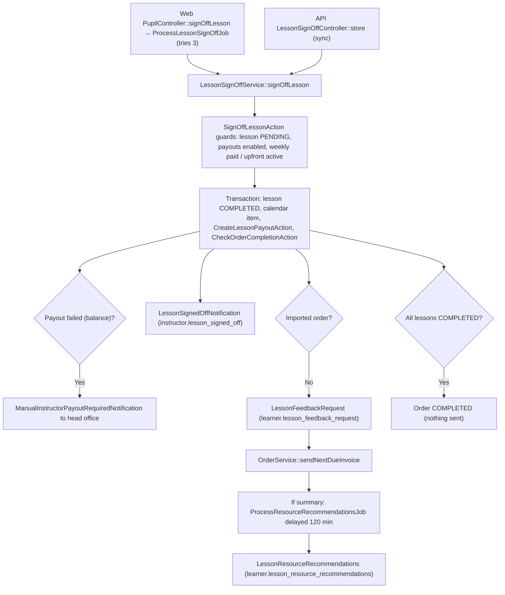

| Step | Trigger & timing | What happens (code ref) | Sent (channel → template/notification) | Recipient |
|---|---|---|---|---|
| 1 | Instructor signs off (web: queued job; API: sync) | `LessonSignOffService::signOffLesson` → `SignOffLessonAction` | — | — |
| 2 | In transaction | Lesson COMPLETED; `CreateLessonPayoutAction` (balance shortfall → FAILED payout returned); `CheckOrderCompletionAction` sets order COMPLETED only when every lesson is COMPLETED | — | — |
| 3 | Payout failed | `LessonSignOffService` | Email (hard-coded `MailMessage`) → `ManualInstructorPayoutRequiredNotification` | `mail.head_office_address` |
| 4 | After sign-off | `LessonSignedOffNotification` (constructed with `isForInstructor = true` only) | Email (templated) → `instructor.lesson_signed_off` | Instructor |
| 5 | After sign-off, non-imported order | `LessonFeedbackRequest` Mailable | Email (templated) → `learner.lesson_feedback_request` | Student email (fallback user email) |
| 6 | Same | `OrderService::sendNextDueInvoice` (weekly) | See section 6 | Contact/learner |
| 7 | Sign-off with summary, + `lessons.recommendations_delay_minutes` (120) | `ProcessResourceRecommendationsJob` (AI tag matching) | Email (templated) → `LessonResourceRecommendations` (`learner.lesson_resource_recommendations`) | Learner |
| 8 | Instructor assigns resources (API `students/{student}/lessons/{lesson}/resources`) | `AssignResourcesToLessonAction` | Email (templated) → `LessonResourcesAssigned` (`learner.lesson_resources_assigned`) | Learner |
| 9 | Guarantee | Granted on first payment (`GrantTestPassGuaranteeAction`) or on `invoice.paid` with guarantee share; revoked on cancellation (section 8) | — | — |
| 10 | Final lesson / order completion | Order status COMPLETED only | **Nothing sent** (no completion, test, or review email) | — |

---

## 10. Messages and account deletion

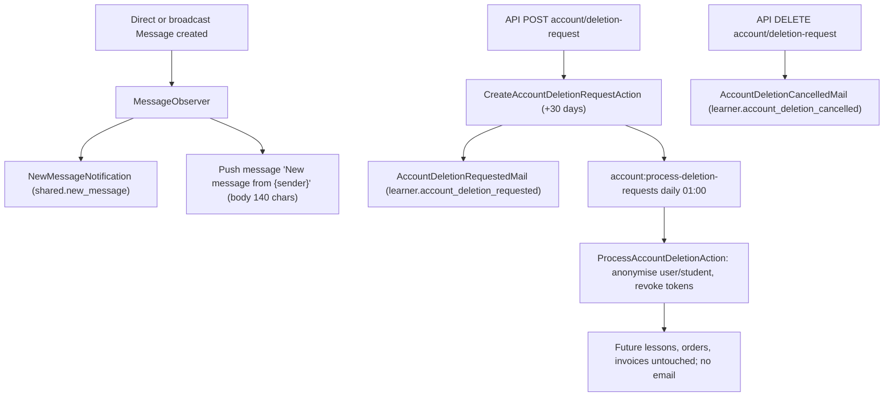

| Step | Trigger & timing | What happens (code ref) | Sent (channel → template/notification) | Recipient |
|---|---|---|---|---|
| 1 | Message sent (direct or broadcast) | `MessageObserver` | Email (templated) → `NewMessageNotification` (`shared.new_message`); Push `message` | Recipient user |
| 2 | Owner manual push | `PushNotificationController` (web) | Push | Chosen users |
| 3 | Learner requests deletion | `CreateAccountDeletionRequestAction`, scheduled for now + 30 days | Email (templated) → `AccountDeletionRequestedMail` (`learner.account_deletion_requested`) | Learner |
| 4 | Learner cancels request | Cancel action | Email (templated) → `AccountDeletionCancelledMail` (`learner.account_deletion_cancelled`) | Learner |
| 5 | `account:process-deletion-requests`, daily 01:00 | `ProcessAccountDeletionAction` anonymises user/student, revokes tokens | Nothing; instructor not notified | — |
| 6 | Bird conversation mirror | `BirdConversationService::sync` via manual `bird:sync {--full}` (read-only mirror) | — | — |

---

## Scheduled commands

All defined in `bootstrap/app.php` → `withSchedule` (`routes/console.php` only contains `inspire`).

| Command | Schedule | Purpose | Learner-relevant output |
|---|---|---|---|
| `calendar:cleanup-drafts` | daily 00:00 | Remove stale draft calendar items | None |
| `orders:release-expired-holds` | every minute, `withoutOverlapping` | `OrderService::releaseExpiredHolds` | None (silent release) |
| `push:send-queued` | every minute | `ProcessPendingNotificationsAction`, up to 100 per run via Expo | All pushes |
| `reminders:send` | every 5 minutes, `withoutOverlapping` | `ReminderService::dispatchAll` (miles start/end, payment due 48h) | `learner.payment_due_soon` + push |
| `lessons:send-invoices` | hourly, `withoutOverlapping` | Backup weekly invoicing (`SendLessonInvoices`) | `learner.lesson_payment_reminder` + push |
| `account:process-deletion-requests` | daily 01:00 | Anonymise accounts past grace period | None |
| `hmrc:monitor-token-expiry` | daily 07:00 | Instructor HMRC (not learner) | — |
| `hmrc:sync-itsa-obligations` | daily 07:15 | Instructor HMRC | — |
| `hmrc:check-refresh-health` | hourly | Instructor HMRC | — |
| `hmrc:prune-year-end-archives` | daily 02:00 | Instructor HMRC | — |
| `bird:sync` | **commented out** (`dailyAt('02:30')`) | Bird conversation mirror | — |
| `import:send-welcome-emails` | manual only (`--instructor=*`, `--only=all\|instructors\|students`, `--dry-run`) | Welcome emails for imports | `learner.welcome` |

## Outbound messages (learner journey)

| Message | Class | Channel / template key | Sent by | Recipient |
|---|---|---|---|---|
| Booking enquiry alert | `BookingEnquirySubmittedMail` | Email (hard-coded Blade, sync `Mail::send`) | `Booking\StepTwoController::notifyAdmin` | `booking.admin_email` |
| Bird contact upsert | `SyncBookingEnquiryToBirdJob` | Bird CRM API | `Booking\StepTwoController::show` | Bird |
| Registered | `StudentRegisteredNotification` | `learner.registered` | `RegisterStudentAction` | Learner |
| Welcome + temp password | `WelcomeStudentNotification` | `learner.welcome` | `CreatePupilAction`, `ResendStudentInviteAction`, `SendOrderConfirmationEmailAction::sendWelcomeEmailIfPending` | Learner |
| Password reset by admin | `PupilPasswordResetMail` | `learner.password_reset` | `AdminResetPasswordAction` | Learner |
| Payment link | `PaymentLinkNotification` | `learner.payment_link` | `SendPaymentLinkEmailAction`, `OrderService::sendPaymentLink/resendPaymentLink` | Contact or learner |
| Payment link re-sent | push | `payment_link_resent` | `OrderService::resendPaymentLink` | Learner |
| Calendar clash | `CalendarClashDetectedNotification` | `instructor.calendar_clash` | `OrderService::checkDraftItemClashes` | Instructor |
| Order confirmation | `OrderConfirmationNotification` | `learner.order_confirmation` | `SendOrderConfirmationEmailAction` | Contact or learner |
| Payment received | `LessonPaymentReceivedNotification` | `learner.lesson_payment_received` | `SendPaymentReceivedEmailsAction` | Contact or learner |
| Payment received (instructor) | `InstructorLessonPaymentReceivedNotification` | `instructor.lesson_payment_received` | `SendPaymentReceivedEmailsAction` | Order instructor |
| Lesson(s) paid | push | `lesson_paid` | `NotifyInstructorOfLessonPaidAction` | Order instructor |
| Released order paid | `ReleasedOrderPaidNotification` | Email (hard-coded) | `OrderService::reportPaymentForReleasedOrder` | Head office |
| Weekly invoice | `LessonPaymentReminderNotification` | `learner.lesson_payment_reminder` | `SendLessonInvoiceAction`, `ResendLessonInvoiceAction` | Contact or learner |
| Time to pay | push | `lesson_payment` | `SendLessonInvoiceAction` | `student->user` |
| Payment due soon | `PaymentDueSoonNotification` | `learner.payment_due_soon` | `SendPaymentReminderAction` | Booker email |
| Payment reminder | push | `payment_due_48h` | `SendPaymentReminderAction` | Learner (if owns account) |
| Mileage reminders | push | `miles_start`, `miles_end` | Reminder actions | Instructor |
| Instructor on way | `InstructorOnWayNotification` + push | `learner.instructor_on_way` / `instructor_on_way` | `MessageObserver::handleLessonStatus` | Learner |
| Instructor arrived | `InstructorArrivedNotification` + push | `learner.instructor_arrived` / `instructor_arrived` | `MessageObserver::handleLessonStatus` | Learner |
| Slot offer | push | `slot_offer` ("Short Notice Lesson Available") | `CreateSlotOfferAction` | Instructor's active students |
| Lesson rescheduled | `LessonRescheduledNotification` | `learner.lesson_rescheduled` | `InstructorService::notifyStudentsOfReschedule` | Student's user |
| Bulk reschedule | `LessonsBulkRescheduledStudentNotification` / `...InstructorNotification` | `learner.lessons_bulk_rescheduled` / `instructor.lessons_bulk_rescheduled` | `MoveLessonAndFutureSiblingsAction` | Student's user / instructor |
| Booking cancelled | `BookingCancelledNotification` | `learner.booking_cancelled` | `CancelBookingAction` | Student's user |
| Refund required | `RefundRequiredNotification` | Email (hard-coded) | `CancelBookingAction` | Head office |
| Transfer | `StudentTransferToStudentNotification`, `StudentLostNotification`, `StudentGainedNotification` | `learner.student_transfer`, `instructor.student_lost`, `instructor.student_gained` | `ExecuteStudentTransferAction` | Learner / old / new instructor |
| Assigned by admin | `StudentAssignedByAdminNotification` | `instructor.student_assigned` | `AssignStudentToInstructorAction` | Instructor |
| Lesson signed off | `LessonSignedOffNotification` | `instructor.lesson_signed_off` | `LessonSignOffService` | Instructor |
| Manual payout required | `ManualInstructorPayoutRequiredNotification` | Email (hard-coded) | `LessonSignOffService` | Head office |
| Feedback request | `LessonFeedbackRequest` | `learner.lesson_feedback_request` | `LessonSignOffService` | Learner |
| Resource recommendations | `LessonResourceRecommendations` | `learner.lesson_resource_recommendations` | `ProcessResourceRecommendationsJob` | Learner |
| Resources assigned | `LessonResourcesAssigned` | `learner.lesson_resources_assigned` | `AssignResourcesToLessonAction` | Learner |
| New message | `NewMessageNotification` + push | `shared.new_message` / `message` | `MessageObserver` | Recipient |
| Deletion requested / cancelled | `AccountDeletionRequestedMail` / `AccountDeletionCancelledMail` | `learner.account_deletion_requested` / `learner.account_deletion_cancelled` | Deletion actions | Learner |

---

## Ambiguities, gaps and dead code

### Gaps in the learner journey

1. **No SMS or WhatsApp from the app.** Bird is only used for a contact upsert and a read-only conversation mirror. Whether Bird automations send SMS/WhatsApp (for example the "we'll notify you when we expand" promise) can't be determined from the code.
2. **No-instructor branch in `/onboarding` is a dead end.** It sends no admin email, no Bird sync, and creates no lead beyond the `Enquiry` row. Only `/booking` alerts the admin and syncs to Bird.
3. **No learner lesson reminders** ("lesson tomorrow / in 1 hour") on any channel. The only time-based learner reminder is `payment_due_48h`.
4. **Silent hold release.** `ReleaseUnpaidOrderAction` notifies neither learner nor instructor. For instructor bookings, the learner's slot simply disappears.
5. **Payment failures only log.** `payment_intent.payment_failed` and `invoice.payment_failed` have no follow-up. An unpaid weekly invoice at lesson time has no automated consequence other than blocking sign-off.
6. **Learners cannot cancel or reschedule.** Only instructor/admin endpoints exist.
7. **Refunds are manual.** There is no Stripe refund call; head office receives `RefundRequiredNotification`.
8. **No completion message.** When the last lesson is signed off or the order becomes COMPLETED, nothing is sent.
9. **Account deletion leaves future lessons, orders and Stripe invoices in place**, and doesn't notify the instructor.
10. **Failed late-cancel payouts** in `CancelBookingAction` don't trigger `ManualInstructorPayoutRequiredNotification` (only sign-off does).

### Inconsistencies and likely bugs

11. **Reschedule doesn't move payment dates.** `UpdateCalendarItemAction::syncLessonDates` and `MoveLessonAndFutureSiblingsAction` don't update `LessonPayment.due_date`, the Stripe invoice due date, existing `payment_due_48h` reminder rows, or `payment_hold_expires_at`.
12. **Transfer leaves `orders.instructor_id` unchanged.** After `ExecuteStudentTransferAction`, `instructor.lesson_payment_received` emails and `lesson_paid` pushes still go to the old instructor (they use the order's instructor), and invoice metadata names the old instructor.
13. **Recipient inconsistency.** Payment emails go to `contact_email` when `owns_account = false`, but cancellation, reschedule, transfer, feedback, recommendation and on-way/arrived emails go to the learner's user/email. The `lesson_payment` push goes to `student->user` without the `owns_account` check used by the other payment pushes.
14. **Hard-coded 48h** in `SendLessonInvoices` and `GetPaymentRemindersDueAction` instead of `booking_payments.weekly_payment_due_hours_before_lesson`. Changing the config won't move those.
15. **Date vs datetime comparison.** `SendLessonInvoices` compares the `due_date` date column with `now()->addHours(48)`. Since `due_date` is already lesson − 48h, invoices go out roughly 2 to 4 days before the lesson. The exact lead time depends on DB date casting and can't be determined precisely without running the code.
16. **Short Stripe session vs learner hold.** The learner hold is 10 min, but the Stripe session lasts at least 31 min (`stripeCheckoutExpiresAt`). A learner paying between minute 10 and minute 31 may pay for an already released order, which triggers `ReleasedOrderPaidNotification` and a manual refund.
17. **Partially cancelled orders never complete.** `CheckOrderCompletionAction` requires every lesson to be COMPLETED, so a cancelled lesson blocks COMPLETED. Conversely, `CancelBookingAction` can set an order CANCELLED even though earlier lessons were completed.
18. **`invoice.paid` has no guard** for a cancelled lesson or an already-PAID `LessonPayment`.
19. **Slot offers stay `Booked`** after the resulting order is released unpaid. `ReleaseUnpaidOrderAction` doesn't touch `SlotOffer`.
20. **Forced marketing consent.** Both step-1 controllers set `marketing_consent = true` ("bundled consent per client instruction"), while the `BirdContactService` docblock states that bundling consent is a GDPR breach. Bird `subscribedSms/WhatsApp/Email` are set from this forced value.
21. **Welcome copy mismatch.** Self-booked onboarding learners receive `learner.welcome` on first payment, whose copy says the instructor "has added you", which doesn't fit a self-booking.
22. **Imported learners who pay before `import:send-welcome-emails` runs** get the welcome email through `SendOrderConfirmationEmailAction`. The command then won't resend it if the flag was cleared; the exact behaviour depends on flag handling.
23. **Payment-link push asymmetry.** The initial instructor booking (`SendPaymentLinkEmailAction`) sends no push; only the resend does.
24. **Push delivery has no retry.** Failed Expo sends aren't retried by `ProcessPendingNotificationsAction`.
25. **Stripe-sent invoice emails.** Invoices are created with `collection_method = send_invoice` and finalized, but the code never calls Stripe's send-invoice endpoint. Whether Stripe emails the learner depends on dashboard settings and can't be determined from the code.
26. **On-way/arrived push payload** uses `notification_type` rather than `type` like the other catalog entries. Whether the mobile app handles both can't be determined from this repo.

### Dead or unused code (verified by grep)

27. `App\Jobs\NotifyInstructorOfLesson` is never dispatched and contains a TODO.
28. The `learner.lesson_signed_off` template is never sent. `LessonSignedOffNotification` is only constructed with `isForInstructor = true`, and the service comment says students intentionally no longer receive it.
29. `EnquiryObserver` only logs ("TODO: Replace with actual HTTP call to marketing system").
30. `bird:sync` isn't scheduled (the line is commented out in `bootstrap/app.php`), although the `BirdConversationService::sync` docblock says it is "used by the nightly schedule".
31. `WebhookController::createLessonsForOrder` is a legacy path for old upfront orders created without lessons. It's reachable only for such legacy orders.
32. `Onboarding\StepFourController::getInstructorTags()` is a private method with no callers.
33. `Onboarding\StepFiveController` passes hard-coded `'available_promos' => ['SAVE10', 'SAVE20']` ("for demo").
34. Every other Notification and Mailable listed above has at least one call site. `StudentRegisteredNotification` is in use and not dead.
